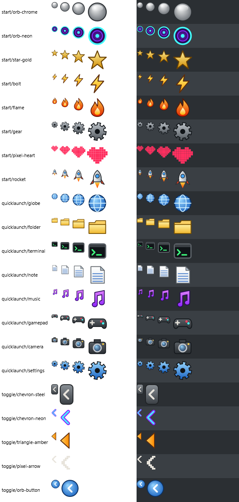

# RetroBar-Extreme example icons

Original icons for trying out custom icons. They were drawn in code for this project (the
generator is in `IconGenerator.cs.txt`), so you can use and change them freely, under the same
licence as RetroBar.

| Folder | Use it for | Where to set it |
|---|---|---|
| `start/` | Start button emblem: chrome orb, neon orb, gold star, bolt, flame, gear, pixel heart, rocket | Properties → Layout → Start button → **Icon: Choose PNG...** |
| `quicklaunch/` | Quick launch shortcuts: globe, folder, terminal, note, music, gamepad, camera, settings | Right-click a quick launch icon → **Change icon...** |
| `toggle/` | Notification area expand/collapse button: steel chevron, neon chevron, amber triangle, pixel arrow, orb button | Properties → Layout → Notification area toggle → **Choose PNG...** |

## Sizes

- `start/` and `quicklaunch/` come in `16px`, `24px`, `32px` and `48px` folders.
  - Pick the size for your taskbar scale: 16 px at 100%, 24 px at 150%, 32 px at 200%.
  - Better still, pick any one of them. RetroBar sees the matching files in the other size folders, keeps them all, and uses the sharpest one for your scale.
- `toggle/` comes in `100%` and `200%`. The arrows point left (collapsed), and RetroBar mirrors them while the area is expanded.
