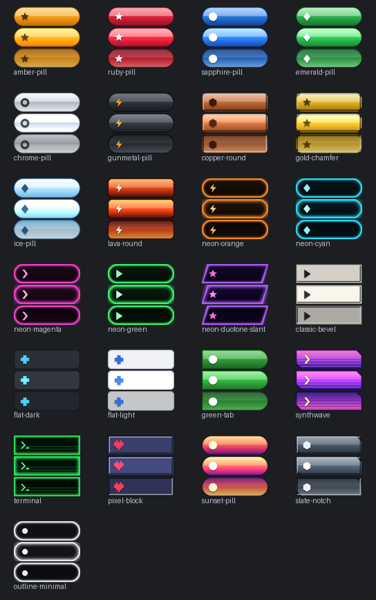

# Start button pictures

Twenty-five ready-made Start buttons, each in a one-picture and a three-state version, and everything you need to make your own. The buttons carry **no symbol**: pair them with a Start icon (see below) so the icon can be changed, hidden, centred or swapped separately.
All of them were drawn in code for this project (`source/make_buttons.py`), so use and change
them freely under the same licence as RetroBar.

## Use one (30 seconds)

1. Right-click the taskbar → **Properties → Icons**.
2. Under **Start button**, press **3 state...** to pick from `3state/` (normal, hover and pressed looks) or **1 state...** to pick from `1state/` (one look). Each button opens its own folder, and the one you press tells RetroBar what the picture holds.
3. Pick a symbol with **Icon: Choose PNG...** from `Extras\Icons\start` — every button has a matching `btn-<name>.png` there in four sizes (16, 24, 32, 48 px) — or any icon you like. **Icon position** puts it left, centre or right on the button.
4. On the **Layout** tab, tick **Show icon** and leave **Show "start" text** off (or on, for a label next to the icon).

**Theme** next to the picture returns to the theme's own button. The Vista-style floating orb always keeps its own picture.

## Make your own

Any PNG works. There are two layouts.

### One picture

A single image used for every state. Use it for anything simple (`1state/` has one for every button). A Start *icon* from `Extras\Icons\start` makes a perfectly good one-picture button too.

### Three states stacked

Three frames of the **same size**, one above the other, in this order:

| Frame | Top to bottom | Shown when |
|---|---|---|
| 1 | normal | the button is idle |
| 2 | hover | the mouse is over it |
| 3 | pressed | the button is held down, or the Start menu is open |

`template-3state.png` shows the layout with the frames marked. `template-blank.png` is the same on a transparent canvas, with a one pixel outline per frame to paint inside (delete the outlines before you use it).

### Size

- One image pixel is one pixel at 100% taskbar scale. The button is as big as the picture: a 96 x 84 stacked image is a 96 x 28 button. The examples are **96 x 28 per frame**; classic taskbars are 28 to 32 px tall.
- Taskbar scale enlarges the picture. For crisp results at 200%, draw at double size (192 x 56 per frame) and use **Scaling: Native size (sharp)**, or keep pixel art at 1x and let it enlarge by whole numbers.
- Largest allowed: 512 x 512 px and 4 MB.

### Transparency

Use it. Rounded and slanted shapes should have transparent corners; soft glows and shadows are fine (keep them inside the frame, or they are cut off). Keep the glow inside a frame so it doesn't spill into the frame above or below.

### Length, thickness and turning

You draw the button horizontally. The **Layout** tab then decides the rest:

- **Orientation** turns it to read up or down a side taskbar or a bar's vertical edge.
- **Length / Thickness: Automatic** keeps the picture's own size. **Custom** sets a size in px.
- **Stretch: Keep ends (repeat the middle)** makes a longer button without squashing the ends: it repeats one pixel column at about 45% of the width. **Keep that column plain** (no symbol or texture detail running through it). A symbol belongs near the left end. **Scale the whole button** stretches everything instead.
- **Gap to edge** keeps a custom button one pixel off the taskbar's border (set it to 0 to touch it).

### Tips

- Make hover a little lighter and pressed a little darker, with the symbol one pixel lower. People notice that more than any colour change.
- The same artwork works with RetroBar's colour tools only if you draw it in the colours you want. A picture is used exactly as it is, and the theme's recolouring does not touch it.
- After you edit a file, press **Choose PNG...** again to pick it up. RetroBar keeps its own copy of the picture in `%LOCALAPPDATA%\RetroBar\Icons`.
- Keep the symbol inside the left 24 px if you want the same file to work when the button is made shorter.

## Make a whole set with code

`source/make_buttons.py` draws everything here. Each button is one entry of a small dictionary: a body shape, gradient colours, an optional border, gloss, bevel and symbol. Copy an entry, change the colours, run `python make_buttons.py` (it needs `pip install pillow`), and your button appears next to the others, in `preview.png` too.

## What is in this folder

| File | |
|---|---|
| `3state/*.png` | The buttons with normal, hover and pressed frames, each 96 x 84 (three 96 x 28 frames). Load with **3 state...**. |
| `1state/*.png` | The same buttons, normal look only, each 96 x 28. Load with **1 state...**. |
| `Extras\Icons\start\<size>pxtn-*.png` | The symbol of each button as a Start icon (16, 24, 32 and 48 px). |
| `preview.png` | Every button in all three states, with its matching icon drawn on top. |
| `template-3state.png` | Reference for the frame layout and sizes. |
| `template-blank.png` / `template-single-blank.png` | Empty canvases of the same size to paint on. |
| `source/make_buttons.py` | The generator. |
