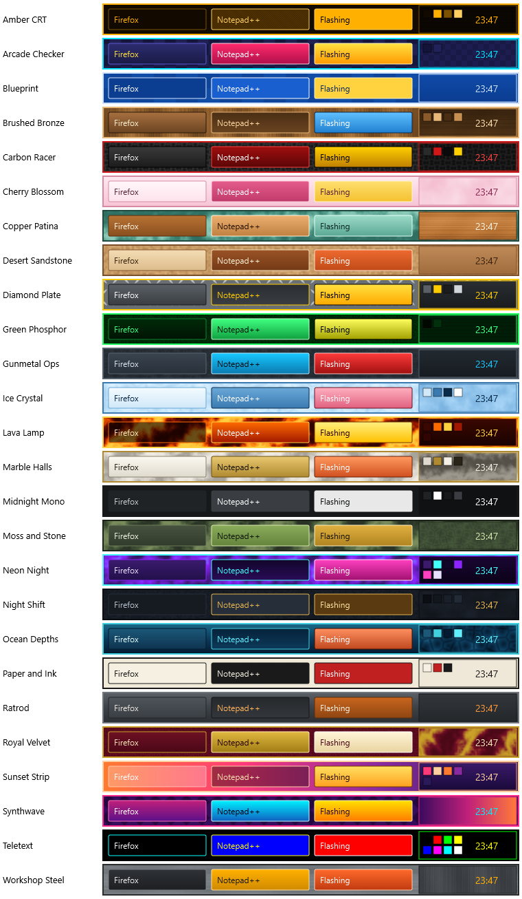

# RetroBar-Extreme example styles

Twenty-six ready-made styles that show what the style system can do. They're built into RetroBar:
open Properties → **Colours** → **Saved styles**, pick one and click **Load**. It applies straight
away, over whatever theme you're using. Tweak it from there, and **Save** it under your own name.

Your own saved style with the same name takes the example's place. Delete yours to get the example
back. Every build also has these files in its `Extras\Styles` folder; **Import...** reads them too.

| Style | Shows off | Font to try |
|---|---|---|
| **Amber CRT** | Fine scanlines, a 45° scanline active button, borderless buttons; try the pixel-arrow toggle | Latchline Mono |
| **Arcade Checker** | The checker texture, a palette-coloured tray texture, double-thick button borders | Pixel Cell |
| **Blueprint** | A soft drafting-grid checker, white linework, flat buttons | Latchline Mono |
| **Brushed Bronze** | Brushed texture turned to vertical strokes, triple-thick Start border | Rivet Condensed |
| **Carbon Racer** | Carbon-fibre texture, racing red, double task button borders | Torque Plate |
| **Cherry Blossom** | Light pink gradients, a petal-cloud tray, dark text on a light bar | Camber Script |
| **Copper Patina** | Verdigris marble turned 60°, copper buttons, a horizontally brushed tray | Flypress |
| **Desert Sandstone** | Sandstone noise, light buttons with dark text, terracotta accents | Tallow Condensed |
| **Diamond Plate** | Diamond-plate texture, hazard-yellow accents, thick bar and tray borders | Torque Plate |
| **Green Phosphor** | Noise glow, a tray texture that takes its colours from the palette | Pinfeed Grid |
| **Gunmetal Ops** | Cellular armour plate, ice-blue active button, thick bar and tray borders | Torque Plate |
| **Ice Crystal** | Frosty cells, angled clouds on the tray, cool blues | Ferrule |
| **Lava Lamp** | Hot marble turned 30°, dark glass buttons | Sling Arc |
| **Marble Halls** | Light marble with turned veins, gold accents, dark text on a light bar | Quoin Serif |
| **Midnight Mono** | Minimal and flat: no borders, one white accent; pairs with icon-only task buttons | Collet Sans |
| **Moss and Stone** | Mossy marble turned 15°, a lichen tray made of cells | Quoin Serif |
| **Neon Night** | Clouds texture bar, neon gradients, palette-driven, thicker tray borders, purple Start recolour | Quantum Step |
| **Night Shift** | Low glare; bar and tray textures coloured from four palette slots, so the palette re-tints it | Knurled Swarf |
| **Ocean Depths** | Three-stop gradient bar, cellular caustics on the tray | Bushing Sans |
| **Paper and Ink** | Light and flat; double-thick bevels everywhere (great on 95-98 / 2000) | Plinth Mono |
| **Ratrod** | Steel gradients with one warm accent (the original example) | Rivet Condensed |
| **Royal Velvet** | Crushed-velvet noise, gold-veined marble tray, a thicker Start border | Pebble |
| **Sunset Strip** | A horizontal (0°) gradient across the bar, see-through buttons (`#aarrggbb`) | Sling Arc |
| **Synthwave** | A checker turned 45° into an argyle grid, a three-stop sunset gradient on the tray | Sling Arc |
| **Teletext** | Flat black and the eight teletext colours, no gradients | Null Cartridge |
| **Workshop Steel** | Steel brushed horizontally (0°), safety-amber active button, heavier Start and button borders | Rivet Condensed |

The fonts are built into RetroBar too: Properties → **Style** → **Font** (see `Extras\Fonts\README.md`).

Parts a style leaves out keep the theme's own look.
- **Classic themes** (95-98, 2000, …) draw the bar, tray and Start button in one colour, so the tray settings only show on XP, Vista, Longhorn and Watercolor.
- **Start recolouring** applies to the image-based Start buttons of XP, Vista and Longhorn.

The file format is plain JSON with comments; open any of these files to see it.
- **Brushes:** colour, gradient or texture.
- **Other settings:** `palette`, `borders` and `start`.
- **Border values** multiply the theme's own thickness: `0` hides a border, `2` doubles it.

`Broken.json` is a test file, kept in the repository only: it shows that a bad style is skipped and never stops RetroBar.
